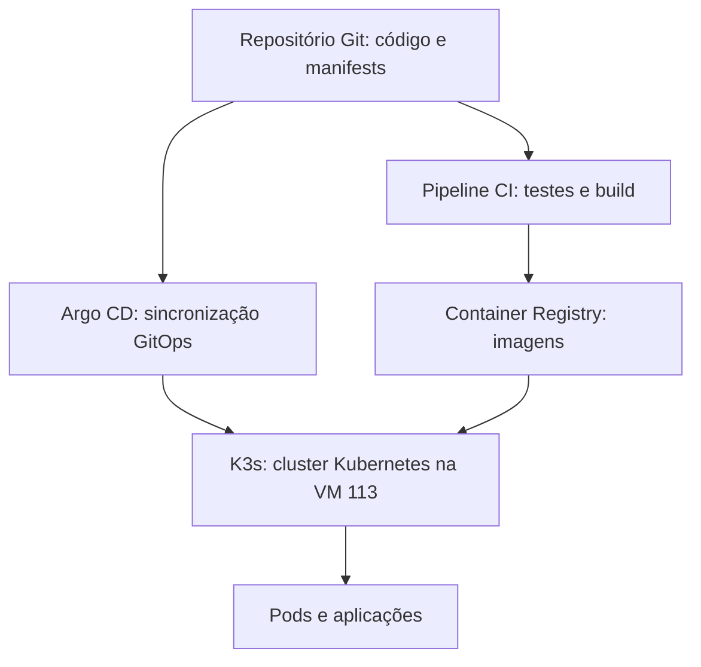

# DevOps Lab — Diário técnico e roteiro de aprendizado

> **Comando de manutenção da documentação:** “atualizar md do labs”. Ao solicitar isso, registrar os procedimentos realmente executados, os resultados observados, os problemas e as soluções, sem marcar como concluído o que ainda não foi validado.

## 1. Objetivo

Construir um laboratório DevOps em uma VM Proxmox para aprender os fundamentos de Kubernetes e praticar entrega de aplicações com CI/CD e GitOps. O aprendizado será incremental: **entender o conceito, explicar cada comando e seu impacto, executar, validar e documentar**.

## 2. Infraestrutura inicial

| Item | Configuração conhecida |
|---|---|
| Hipervisor | Proxmox VE |
| VM | 113 — `devops-lab` |
| Sistema operacional | Debian 12 (Bookworm) |
| CPU | 2 vCPUs |
| Memória | 4 GiB alocados (~3,8 GiB visíveis no sistema) |
| Disco | 40 GB (aprox. 37 GB disponíveis no diagnóstico inicial) |
| IP público | `173.208.136.198/29` — `eth0` |
| IP privado | `10.0.0.14/24` — `enp6s19` |
| Roteador privado / VPN | VM 101 — `10.0.0.1` |
| Rede dos clientes WireGuard | `10.8.0.0/24` |
| Acesso SSH | `ssh devops-lab`, via VPN e IP privado |

**Segurança atual:** SSH da VM 113 configurado para escutar em `10.0.0.14:22`; autenticação por senha e login SSH de root desabilitados. Testado: acesso privado funcionou e conexão a `173.208.136.198:22` foi recusada. Isso restringe o SSH à interface privada, **não exclusivamente aos clientes WireGuard**: outras máquinas com acesso à rede privada ainda podem tentar autenticar-se.

**Escopo:** não modificar a VM 101 nem outras VMs sem necessidade e aprovação. Preservar o acesso via Proxmox para recuperação de problemas de rede.

## 3. Arquitetura pretendida



**Nota:** arquitetura planejada; os componentes de CI, registry, Argo CD e K3s ainda não estão instalados.

## 4. Roteiro de aprendizado

| Etapa | Tema | Conceitos e objetivos | Estado |
|---|---|---|---|
| 1 | Kubernetes e K3s | Cluster, Node, control plane, worker e container runtime; instalar um K3s de nó único | **Em andamento — pré-requisitos** |
| 2 | Pods | Como os containers de uma aplicação são executados | Pendente |
| 3 | Deployments | Estado desejado, réplicas, atualizações e recuperação | Pendente |
| 4 | Services | Descoberta e comunicação entre aplicações | Pendente |
| 5 | Ingress | Exposição HTTP/HTTPS e roteamento de requisições | Pendente |
| 6 | ConfigMaps e Secrets | Separação de configuração e dados sensíveis | Pendente |
| 7 | GitOps | Git como fonte de verdade para o estado do cluster | Pendente |
| 8 | Argo CD | Reconciliação e sincronização GitOps | Pendente |
| 9 | CI/CD | Testes, builds, publicação de imagens e entrega | Pendente |

### 4.1 Conceitos iniciais

- **Docker:** ferramenta conhecida para criar e executar containers.
- **Kubernetes (K8s):** orquestrador de containers que trabalha para manter o estado desejado das aplicações. “K8s” abrevia as oito letras entre K e s.
- **K3s:** distribuição leve do Kubernetes, apropriada para começar em uma VM pequena; inclui containerd.
- **Cluster:** conjunto de nós gerenciados como ambiente Kubernetes; neste laboratório começaremos com apenas um nó.
- **Node (nó):** máquina que participa do cluster; a VM 113 será o nó inicial.
- **Control plane:** componentes que recebem declarações de estado e coordenam o cluster.
- **Worker:** nó que executa cargas de trabalho; no laboratório de nó único, a mesma VM poderá desempenhar ambos os papéis.
- **Container runtime:** software que executa os containers; o K3s inclui containerd, sem exigir Docker instalado separadamente.

## 5. Registro de atividades

### Registro 001 — Preparação da rede e do SSH (concluído)

**Objetivo:** permitir administração da VM 113 pelo WireGuard existente, sem expor SSH no IP público.

**Realizado:**

1. Adicionada a segunda NIC da VM 113 na bridge privada `vmbr1`.
2. Configurado IP privado `10.0.0.14/24` na interface `enp6s19`.
3. Adicionada rota de retorno para `10.8.0.0/24` via `10.0.0.1`.
4. Criada configuração persistente de rede em `/etc/netplan/60-vpn-private.yaml` e validada com `netplan try`.
5. Configurado `sshd` para escutar somente em `10.0.0.14:22`.
6. Atualizado o alias SSH local `devops-lab` para usar o IP privado.

**Validações observadas:** ping e SSH para `10.0.0.14` funcionaram pela VPN; tentativa de SSH no IP público retornou `Connection refused`. IP privado e rota permaneceram presentes na checagem posterior.

**Observação:** não foram alteradas as configurações da VM 101 nem das demais VMs.

### Registro 002 — Diagnóstico inicial do laboratório (concluído)

**Comandos e finalidade:**

| Comando | O que verifica | Impacto |
|---|---|---|
| `cat /etc/os-release` | Distribuição e versão do Linux | Somente leitura |
| `free -h` | Memória e swap | Somente leitura |
| `df -h /` | Espaço na partição raiz | Somente leitura |
| `nproc` | Quantidade de CPUs lógicas | Somente leitura |
| `ip -br addr` | Interfaces e endereços IP | Somente leitura |
| `command -v k3s` | Presença do executável K3s | Somente leitura |
| `command -v kubectl` | Presença do cliente Kubernetes | Somente leitura |
| `command -v docker` | Presença do Docker | Somente leitura |
| `command -v containerd` | Presença de containerd no PATH | Somente leitura |
| `ping -c 3 1.1.1.1` | Conectividade IP com a internet | Envia pacotes de teste |
| `getent hosts github.com` | Resolução DNS | Consulta de nomes |
| `ip route` | Tabela de roteamento | Somente leitura |

**Resultados:** Debian 12; 2 vCPUs; ~3,5 GiB RAM disponível; disco de 40 GB com ~37 GB livres; sem swap; executáveis K3s, kubectl, Docker e containerd não encontrados no PATH. Ping a `1.1.1.1` com 0% de perda e DNS para `github.com` funcionando. Rota padrão pela interface pública; rota WireGuard pela rede privada.

### Registro 003 — Pré-requisitos K3s (em andamento)

**Próxima verificação solicitada:**

```bash
lsmod | grep -E 'overlay|br_netfilter'
```

**O que faz:** consulta os módulos carregados no kernel e procura `overlay` e `br_netfilter`. **Impacto:** somente leitura. A ausência de saída não prova que os recursos estejam indisponíveis.

**Pendente:** analisar a saída; explicar componentes e parâmetros antes da instalação; instalar K3s de nó único usando `10.0.0.14` como IP interno e avaliar cuidadosamente a exposição da API e serviços na interface pública.

## 6. Política de recursos e expansão

**Configuração inicial:** 2 vCPUs, 4 GiB RAM e 40 GB de disco. Começar com um cluster K3s de **nó único, sem workers adicionais**.

Antes de instalar Argo CD, registry, ferramentas de observabilidade ou aumentar a quantidade de aplicações, verificar consumo real na VM e disponibilidade de recursos no host Proxmox. **Avisar o responsável pelo laboratório quando a expansão for recomendável**, antes de executar qualquer alteração.

O host Proxmox pode ter espaço disponível, mas a disponibilidade de disco não significa necessariamente disponibilidade de RAM ou CPU. A possível redistribuição de recursos de outras VMs ou de outro usuário do Proxmox requer validação e autorização prévias.

### Histórico de mudanças de capacidade

| Data | Recurso | Antes | Depois | Motivo | Validação | Estado |
|---|---|---|---|---|---|---|
| Inicial | CPU/RAM/disco | — | 2 vCPUs / 4 GiB / 40 GB | Criação do laboratório | Diagnóstico inicial | Registrado |

Quando ampliarmos os recursos, acrescentar aqui a alteração, os testes realizados e eventuais impactos (por exemplo, reinicialização da VM ou expansão do sistema de arquivos).

## 7. Modelo de atualização por etapa

Para cada etapa, documentar:

1. **Conceito:** o que é a ferramenta ou recurso e qual problema resolve; explicar siglas.
2. **Objetivo:** o resultado esperado.
3. **Pré-requisitos:** recursos, dependências e riscos.
4. **Comandos:** comando, explicação de cada opção e impacto no sistema.
5. **Execução:** o que foi realmente realizado.
6. **Validação:** saída observada e critérios de sucesso.
7. **Problemas e soluções:** erros encontrados e como foram resolvidos.
8. **Próximos passos:** pendências e decisões ainda não tomadas.
9. **Recursos:** consumo observado e necessidade de expansão.

**Regra de manutenção:** atualizar o status somente após confirmação dos resultados. Registrar datas reais quando disponíveis; não inventar medições ou saídas de comandos.
