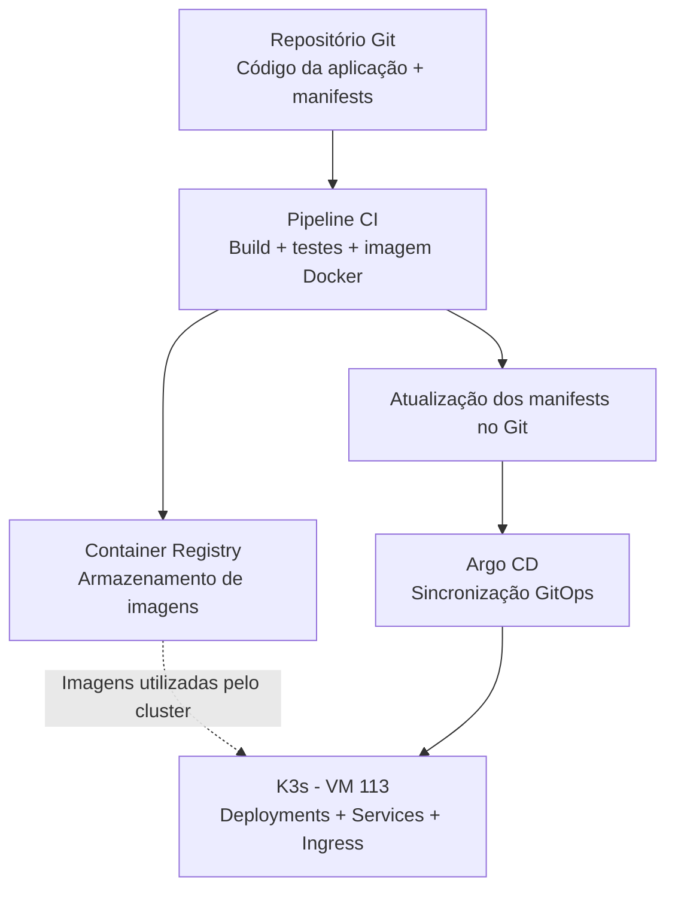

# DevOps Lab

Laboratório prático para estudar e implementar um fluxo completo de **CI/CD, GitOps e Kubernetes**.

## Objetivo

Construir um ambiente de desenvolvimento e deploy em que alterações de código passem por testes, geração de imagens de contêiner, publicação em um registry e implantação automatizada em Kubernetes usando Argo CD.

## Arquitetura proposta



> **Nota:** O fluxo acima é a arquitetura planejada. A implementação de K3s, pipeline, registry e Argo CD ainda será realizada.

## Componentes

| Componente | Responsabilidade |
| --- | --- |
| **Repositório Git** | Versionar o código da aplicação e os manifests Kubernetes. |
| **Pipeline CI** | Executar build e testes, criar uma imagem de contêiner e publicá-la. |
| **Container Registry** | Armazenar as imagens versionadas utilizadas nos deploys. |
| **Argo CD** | Acompanhar a configuração desejada no Git e sincronizá-la com o cluster. |
| **K3s** | Executar as aplicações usando Deployments, Services e Ingress. |

## Fluxo de entrega planejado

1. Uma alteração é enviada ao repositório Git.
2. O pipeline de CI executa os testes e o build.
3. O pipeline gera e publica uma imagem no Container Registry.
4. A referência da imagem nos manifests Kubernetes é atualizada no Git.
5. O Argo CD detecta a mudança e sincroniza o estado desejado com o K3s.
6. O K3s atualiza a aplicação por meio dos recursos Kubernetes.

## Infraestrutura do laboratório

| Recurso | Configuração atual |
| --- | --- |
| Hipervisor | Proxmox VE |
| VM | 113 — `devops-lab` |
| Sistema operacional | Debian 12 |
| CPU | 2 vCPUs |
| Memória | 4 GB |
| Disco | 40 GB |
| IP público | `173.208.136.198` |
| IP privado | `10.0.0.14/24` |
| Rede privada | `vmbr1` |
| Acesso administrativo | SSH no IP privado, por meio do WireGuard |
| Roteador VPN existente | VM 101 — `10.0.0.1` |

O SSH da VM 113 está configurado para escutar apenas em `10.0.0.14:22`. O IP público permanece atribuído à VM, mas não aceita conexões SSH.

## Etapas de implementação

- [x] Criar a VM 113 no Proxmox.
- [x] Configurar acesso SSH por chave.
- [x] Adicionar interface privada e rota para a VPN.
- [x] Restringir o SSH ao IP privado.
- [ ] Validar recursos e conectividade para instalação do cluster.
- [ ] Instalar e configurar K3s em nó único.
- [ ] Fazer o primeiro deploy com Deployment e Service.
- [ ] Configurar Ingress.
- [ ] Definir e configurar um Container Registry.
- [ ] Criar pipeline de CI para build, testes e publicação de imagem.
- [ ] Instalar e configurar Argo CD.
- [ ] Implementar deploy GitOps completo.
- [ ] Adicionar observabilidade de acordo com os recursos disponíveis.

## Acesso à VM

Com o WireGuard ativo no computador local:

```bash
ssh devops-lab
```

O alias SSH deve apontar para o IP privado `10.0.0.14`.

## Considerações

- O laboratório começa com **um único nó K3s**.
- Os recursos da VM são limitados; novos componentes serão instalados gradualmente.
- O acesso administrativo ao servidor deve permanecer restrito à rede privada.
- As mudanças deste laboratório são direcionadas à VM 113, sem exigir alterações nas demais VMs.
